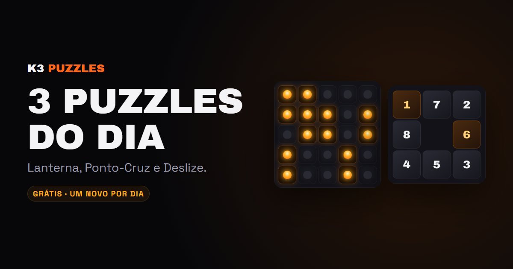

# K3 Puzzles

Três puzzles grátis por dia, iguais pra todo mundo, sem cadastro e sem anúncio. Feitos pelo [K3 Games Studio](https://k3gamesstudio.com).

| | Puzzle | Jogar |
|---|---|---|
| 🏮 | **Lanterna**: acenda todas as 25 lanternas (cada toque vira a lanterna e as 4 vizinhas) | [k3gamesstudio.com/puzzles/lanterna](https://k3gamesstudio.com/puzzles/lanterna/) |
| 🧵 | **Ponto-Cruz**: nonograma 6x6, borde o desenho escondido pelas pistas | [k3gamesstudio.com/puzzles/ponto-cruz](https://k3gamesstudio.com/puzzles/ponto-cruz/) |
| 🧩 | **Deslize**: ponha as peças de 1 a 8 em ordem | [k3gamesstudio.com/puzzles/deslize](https://k3gamesstudio.com/puzzles/deslize/) |

## Como funciona

- HTML, CSS e JS puro, sem build e sem dependências. Abra o `index.html` e jogue.
- O puzzle do dia vem de uma semente com a data (`assets/k3.js`), então todo mundo joga o mesmo desafio. `?d=2026-12-25` abre qualquer dia.
- Todo puzzle gerado tem solução: o Lanterna e o Deslize partem do estado resolvido e embaralham com jogadas válidas; o Ponto-Cruz confere as pistas, não o desenho exato.
- Português ou inglês, conforme o idioma do navegador.
- Teste automático: `node tools/test.mjs` joga os três até vencer, em 3 datas, no PC e no celular.

## Jogos completos

Gostou? Os puzzles são inspirados nos nossos jogos da Google Play: [Lantern Logic](https://play.google.com/store/apps/details?id=com.k3games.lanternlogic) e [Stitch Logic](https://play.google.com/store/apps/details?id=com.k3games.stitchlogic).

Desenvolvido por [Kelvin Biffi](https://kelvinbiffi.com). Licença MIT.
